# ais desktop

A shared graphical workspace for Claude Code and Codex. Browse existing sessions,
continue them with streaming chat, and ask the other agent to review a captured
Git diff. Replies, tool activity, questions and approvals appear directly in the
app. The desktop app shares session readers, project rules, search and annotations
with the `ais` CLI.

## Download a CI build

Every CI run on `main` and on pull requests builds the app and keeps it as the
`ais-desktop-macos-arm64` artifact. It runs on macOS 13 or newer on Apple silicon
and doesn't need any of the build tools below.

To download the build from the latest successful run on `main` with the GitHub CLI:

```sh
run=$(gh run list --repo caanmert/ai-session-tool --workflow CI --branch main --status success --limit 1 --json databaseId -q '.[0].databaseId')
gh run download "$run" --repo caanmert/ai-session-tool -n ais-desktop-macos-arm64
ditto -x -k ais-desktop-macos-arm64.zip .
open ais-desktop.app
```

Without the GitHub CLI, open the repository's **Actions** tab, choose the latest
successful **CI** run on `main`, and download **ais-desktop-macos-arm64** under
**Artifacts**. You need to be signed in to GitHub. The download is a zip that
contains `ais-desktop-macos-arm64.zip`; unzip both to get `ais-desktop.app`, then
move it to Applications.

CI builds are ad-hoc signed, not signed with a Developer ID or notarized. Apps
downloaded with `gh` open normally. macOS quarantines browser downloads, so the
first time you open one it says Apple could not verify the app. On macOS 15 or
later, open **System Settings → Privacy & Security** and click **Open Anyway**. On
macOS 13 and 14, Control-click the app and choose **Open**. Only do this for builds
from this repository's CI.

## Build and open

This version targets macOS 13 or newer. Building requires Go 1.25+, Node.js 22.12+
with npm, and Xcode Command Line Tools. Go 1.24.7 remains sufficient for the CLI.
Desktop dependencies live in the separate `desktop/go.mod` module.

Install the pinned Wails tool:

```sh
go install github.com/wailsapp/wails/v2/cmd/wails@v2.15.0
export PATH="$(go env GOPATH)/bin:$PATH"
```

From the repository root:

```sh
sh scripts/build-desktop.sh
open desktop/build/bin/ais-desktop.app
```

The script installs locked frontend dependencies and packages a native app for
your Mac's architecture. The resulting app needs neither Go nor Node to run;
you can move it to Applications. Install and sign in to Codex or Claude Code
separately. Only the provider you use is needed for chat; cross-provider review
requires both. Saved-history browsing works without either executable installed.

Local and CI builds use ad-hoc signing. A Developer ID signed, notarized release
is not yet published. The Homebrew CLI package does not install the desktop app.

## Screenshots

Choose **System**, **Light**, or **Dark** under **Settings › Look**.
System follows macOS appearance changes; an explicit choice stays active until
you change it. The app remembers the preference in its WebView storage and applies
it before the workspace loads. If the preference cannot be saved, it still
applies for the current visit and Settings explains that limitation.

These show the real React interface with fictional conversations and review data.
They demonstrate the layout, not output from a live model run.

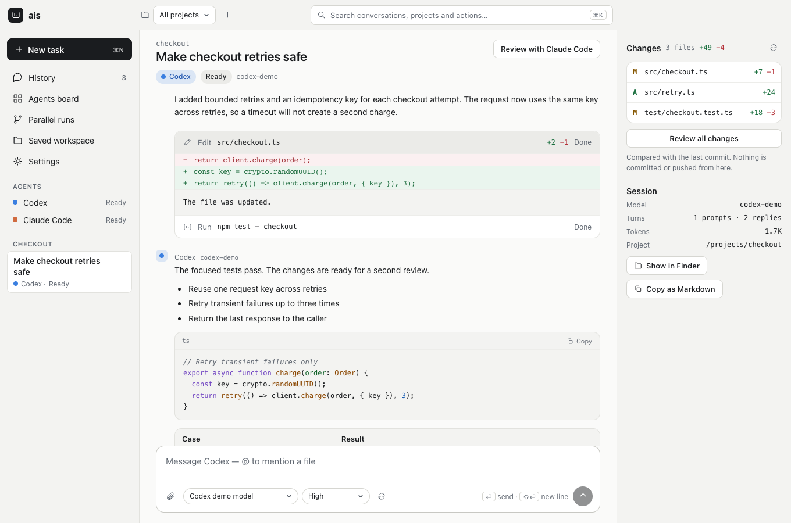

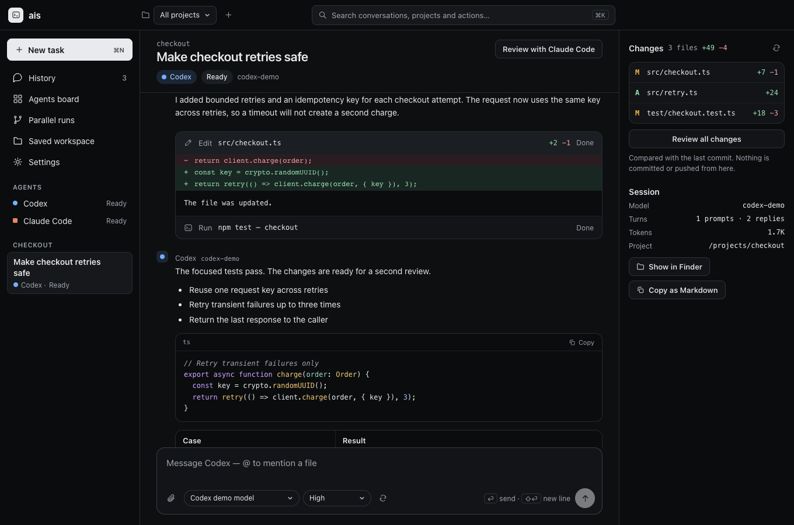

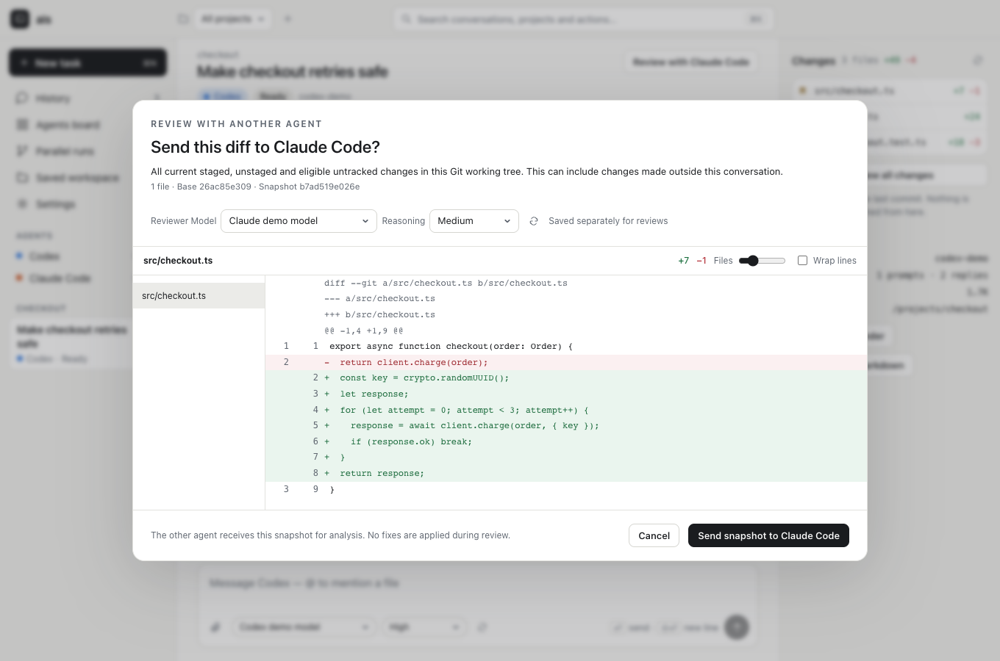

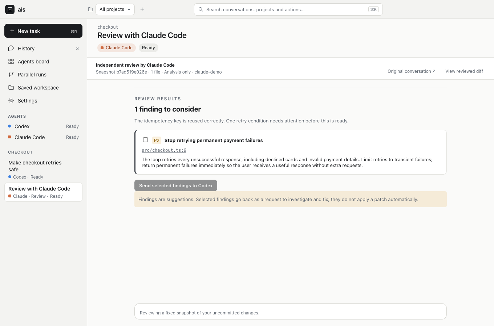

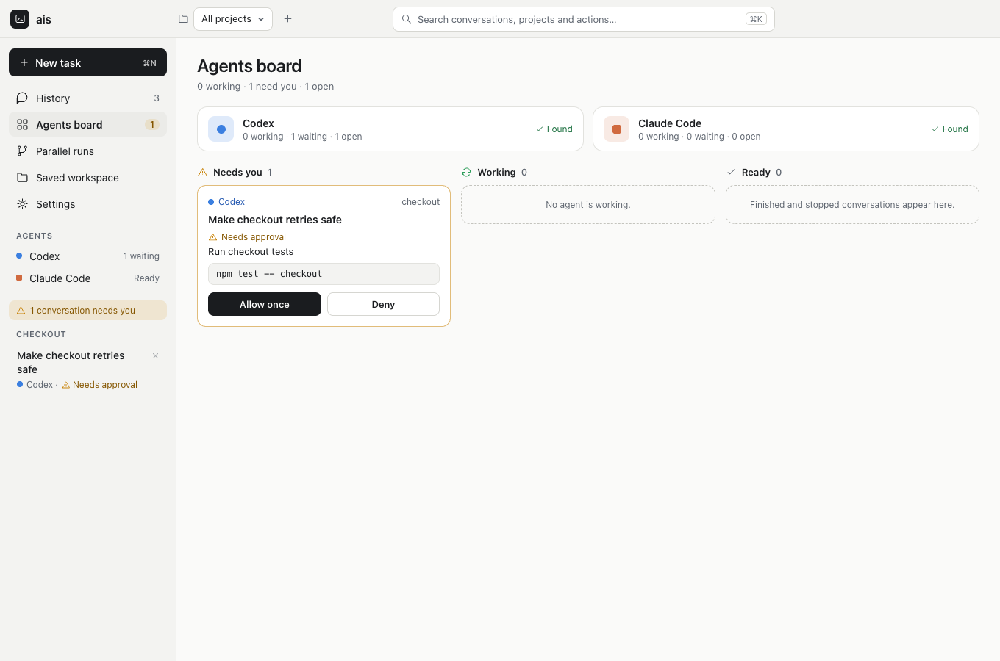

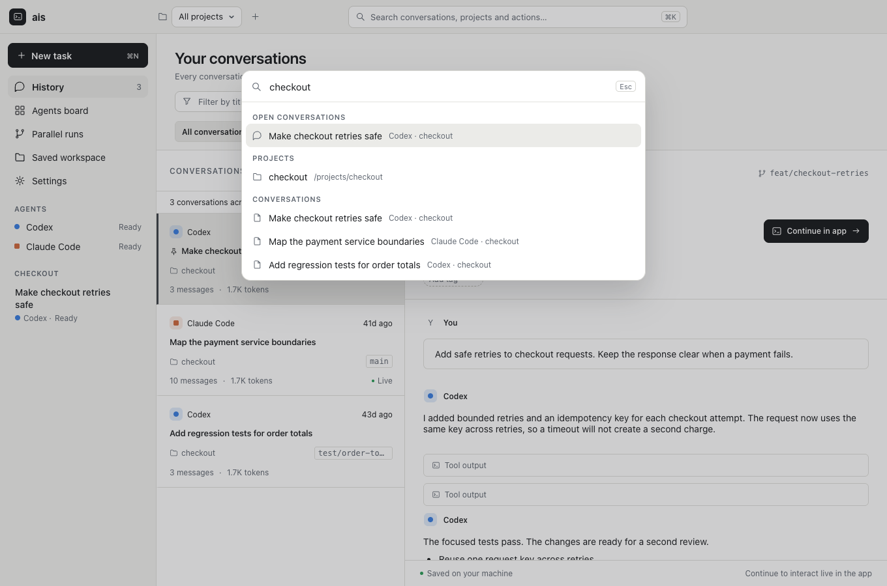

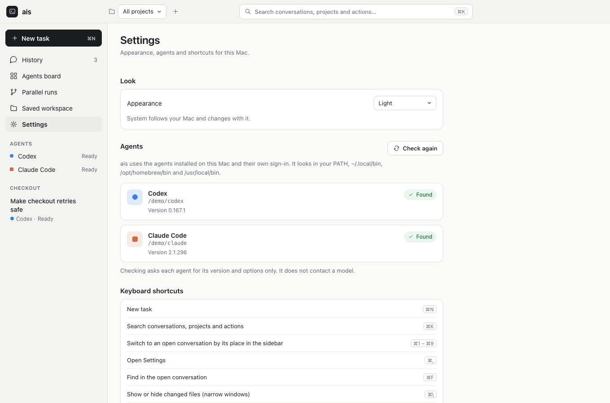

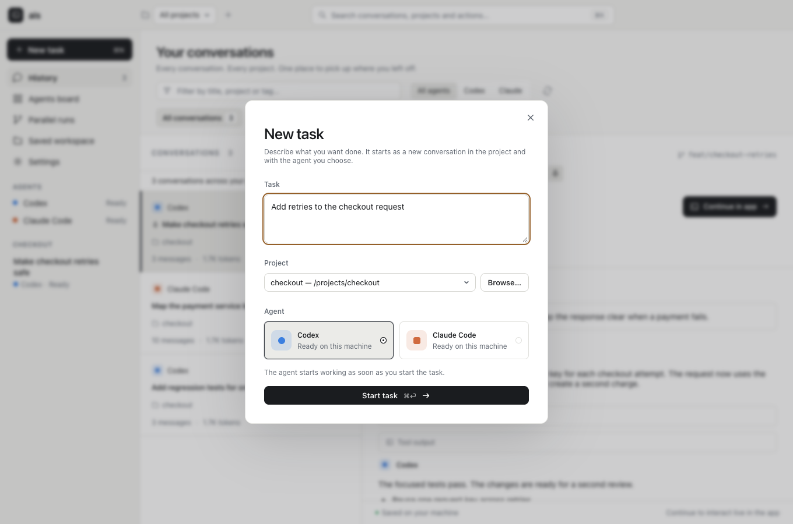

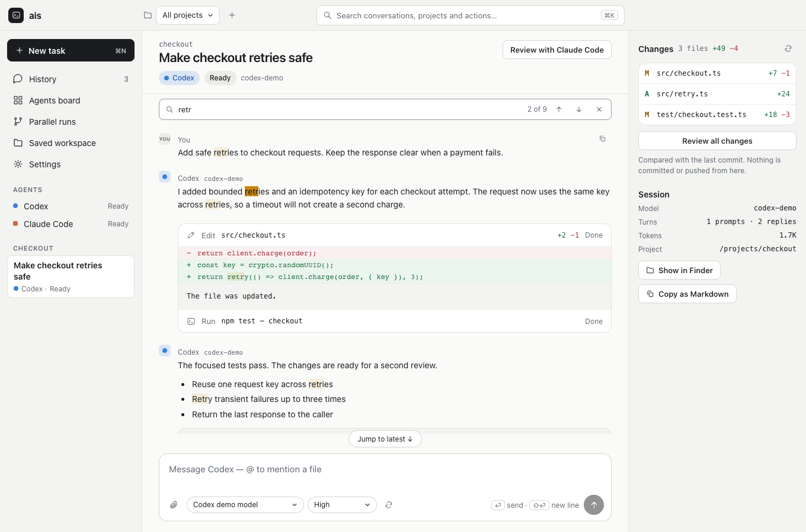

## Finding your way around

- **Top bar**: the project switcher (with a button to add a project folder) and
  the search field, which opens the command palette.
- **Sidebar**: **New task**, then **History**, **Agents board**, **Parallel runs**,
  **Saved workspace** and **Settings**; the two agents with how many of their
  conversations are running or waiting; and your open conversations grouped by
  project. A conversation that needs you is marked with an icon and warning text,
  and the Dock icon shows how many are waiting. While ais is in the background, a
  notification banner tells you when an agent needs approval, has a question,
  finishes or stops with an error; macOS asks for permission the first time, and
  **Settings › Notifications** turns the banners off.
- **Command palette** (**⌘K**): jump to an action, an open conversation, a project
  or any saved conversation. Choosing a saved conversation only shows it in
  History; it never starts an agent.
- **Issues & PRs**: the open issues and pull requests of a project on GitHub, read
  with the GitHub CLI (`gh`) you are signed in to. Filter by title, number, label or
  author; pull requests show their branch, draft state, review decision and checks
  in words. **Start task** on an issue opens New task with the issue's title, link
  and description as the task, in that project; nothing is sent until you start
  it. The 50 most recent of each are listed.

  **New issue…** writes an issue for the project's repository: a title, a
  Markdown description and any of the repository's labels. It is created with
  `gh issue create` only when you choose **Create issue** (or **⌘⏎**; Enter alone
  never creates it), as you, so anyone who can see the repository can read it.
  It never assigns people or adds the issue to a project. The dialog then shows
  the new issue's number with **Open on GitHub**, and the list reloads. Creating
  an issue is the only change this page makes on GitHub.
- **Agents board**: every open conversation in three columns, **Needs you** first.
  A simple approval can be allowed once or denied on its card; requests with
  questions are answered in the conversation. Tasks of the four newest parallel
  runs appear in the same columns: an outlined chip gives the process state
  (Running, Exited) and a separate filled chip marks an agent event or a task
  that has gone quiet. Choosing a run task opens it on the Parallel runs page.
  The board only reads run state; it never starts or stops a run. Each agent's
  card at the top shows its limit closest to running out, such as "88% of week ·
  resets 17:29" (amber near a limit, red when one is used up), and opens
  **Usage limits**. An agent whose limits could not be read shows no bar.
- **Session** (below Changes): the model, turns, tokens and, where the model has
  a known price, what the usage would cost at API list prices. That figure is an
  equivalent: a subscription is not billed this way. **Show in Finder** opens the
  project folder and **Copy as Markdown** copies the conversation without tool
  output. **File an issue…** opens the same New issue dialog for the
  conversation's project, starting from its title and the agent's latest reply
  for you to edit. Pull requests are opened from **Pull request…** under the
  changed files.
- **Changes** (right of a conversation; the **Changes** button or **⌘\\** hides
  and shows it, and opens it as a drawer in a narrow window; a hidden panel stays
  hidden until you show it again): the project's uncommitted files against the last commit, with
  added and removed line counts. Click a file or **Review all changes** to read the
  diff. Nothing is reverted from here. A folder that is not a Git repository
  simply says so.
- **Commit…** (below the changed files) makes a local commit of the files you
  check, with a message prefilled from the conversation title. Other staged work is
  left out and stays staged; Git hooks and commit signing run as they do in a
  terminal. If a hook rejects the commit, the repository is left exactly as it
  was and the hook's message is shown. On the default branch the dialog offers to
  commit on a new branch (checked by default). It is not available while the agent
  is working. **⌘⏎** commits; **Enter** adds a line to the message. Nothing is
  pushed.
- **Pull request…** pushes the current branch and opens a pull request on GitHub
  with the GitHub CLI (`gh`) you are signed in to. The dialog names the branch,
  remote, base branch and repository before anything happens, and offers a draft.
  If the branch already has an open pull request, it pushes new commits to it
  instead. Pushes are never forced, and nothing is merged. Without `gh`, on the
  default branch, or with nothing to propose, the dialog explains why.

## Usage limits

**Usage limits** in the sidebar shows how much of each agent's plan limits you have
used and when each limit resets, as the agents report them for the account they are
signed in to: the same figures as Claude Code's `/usage` and Codex's `/status`.

- **Claude Code** reports the 5-hour session and the weekly limits (all models, and
  per model where your plan has one), whether extra usage is on, and where the
  week's usage went. It is asked with the `get_usage` request of a session started
  with no tools, MCP servers or slash commands.
- **Codex** reports its windows (for example weekly, or 5-hour and weekly) and any
  free full resets you have. It is asked with the app server's
  `account/rateLimits/read`. ais shows the free resets and never uses one.

Reading limits starts no model turn and leaves no conversation behind. Under each
agent in the sidebar, a line such as "Session 59% · Week 88%" turns amber near a
limit and red when one is used up; it opens the page. ais reads the limits when it
starts, every ten minutes while it is in front, when it comes back to the front after
a while, just after a limit's reset time, and when you choose **Refresh**. A read is
reused for a minute. If an agent can't report limits, for example when it is signed
in with an API key or is an older version, the page says why.

## Compare two agents

With both agents installed, choose **Both, compared** in New task and describe the
task. Each agent gets the same text in its own Git worktree and branch
(`ais-compare/<id>/<agent>`), started from the project's last commit, under
`worktrees/` in the ais data directory. Uncommitted changes in your project are not
included, and the agents cannot touch each other's files or your working tree.

Both conversations open side by side in the sidebar and work like any other
conversation: answer approvals, send follow-ups, commit, or open a pull request from
their branch. **Compare** in either header shows both sides: status, the files each
changed with line counts measured from the starting commit (including commits an
agent made), and both diffs of a file next to each other.

**Use this version…** copies one side's changes into your project's working tree
after a confirmation. Nothing is committed. If your project has its own uncommitted
changes in any of those files, or the changes no longer apply, nothing is copied
and the dialog says why. **Remove comparison…** deletes both worktrees and branches
and closes both conversations after a confirmation; changes that were not copied
or committed and pushed are lost.

## Start or continue a conversation

1. Open **History** and, if you like, pick a project in the top bar. Filter by
   titles, project paths, branches, tags and conversation contents; use the agent
   filters to narrow results.
2. Select a saved conversation to preview it. The preview reads like an open
   conversation: tool calls as steps such as "Run `npm test`" with their results,
   long runs of steps folded to a summary, and the time of each message. **Continue in app** opens that
   provider's saved session in its recorded directory.
3. For a fresh conversation, choose **New task** (**⌘N**). Describe the task,
   select a project and agent, then **Start task** (**⌘⏎**): the conversation is
   created and your message is sent in one step. Leave the task empty and choose
   **Start in app** to open the conversation without sending anything. Use
   **Browse** to choose another folder. The app remembers the twelve most recently
   added project folders, and preselects the agent you last started in a project.
   If the first message cannot be sent, the conversation still opens with your
   text in its message box.
4. Type in the message box. **Enter** sends; **Shift+Enter** inserts a new line.
   A new provider process starts when you send the first message. Responses stream
   into the conversation, with tables, task lists and highlighted code blocks
   (each with a copy button). Type **@** to find a file in the project and insert
   its path; the paperclip opens the system file picker instead. Type **/** to
   find one of the agent's skills: Claude Code's skills and plugin commands, or
   Codex's skills for the project, user and system. Choosing one adds `/name`
   (Claude Code) or `$name` (Codex) to the message; it runs when you send.
   Listing skills starts no model turn. **Settings › Skills** lists every skill
   each agent has for a project. **↑** in an
   empty message box recalls your earlier messages.

   Next to the send button, a small ring shows how full the conversation's
   context is after the agent's latest response, for example **84%**; hover it
   for the tokens ("168K of 200K"). It turns amber from 80% and red from 95%,
   when a new conversation is the way to an empty context. The figure comes
   from the agent's own token counts and is saved with the conversation;
   nothing is shown until the agent has reported it. **Session** in the details
   lists the same figure as **Context**.

   While the agent works, **Enter** (or **Queue**) queues your message instead:
   it shows above the box and is sent when the response ends normally. More
   messages join it. If the response is stopped or ends with an error, it is held
   as **Not sent** with **Send now**, **Edit** (back into the box) and
   **Discard**. A queued message is kept on this Mac; one left from before ais
   quit is held, never sent on its own. Images can only be sent once the
   response ends.

   To show the agent a screenshot, paste it into the message box, drop image
   files onto it, or use the image button. Up to six PNG, JPEG, GIF or WebP
   images of at most 5 MB each can go with one message. They are checked by
   their contents, stored with the conversation under `attachments/` in the ais
   data directory with owner-only permissions, and given to the agent with your
   message. Attached images are not part of the saved draft.

   Consecutive tool calls are grouped into one block with a row per step. A row
   says what was done and to what, for example "Read `src/checkout.ts`" or "Run
   `npm test`"; expand it for the output. Edits show how many lines changed and
   expand to the removed and added lines; the latest edit in a block starts
   expanded. Once a turn is done, a block of more than three steps folds to one
   line such as "7 steps · 2 edits · 3 commands · 1 failed"; the turn still
   running stays open.

   Your messages longer than about twelve lines and code blocks longer than 30
   lines are folded with **Show more** / **Show all N lines**. **⌘F** still finds
   text in folded parts and opens them at the match; the output of closed steps
   stays out of the search, as before. Each message shows when it arrived (older
   saved messages may have no time), and **Reuse this message** (the pencil on
   your messages) puts its text in the message box after anything you have
   already written there, without sending it.
5. Answer questions or choose **Allow once** / **Deny** on approval cards. While
   focus is inside a card, **Enter** allows a simple request and **Esc** denies it.
   A command request shows the command and the agent's reason. When the agent
   itself offers a wider grant, the card has a third button and says exactly what
   it does: Claude Code's **Always allow in this project** makes Claude Code add
   the rule to the project's `.claude/settings.local.json`; Codex's **Always allow
   this command** makes Codex add a rule to its own settings. ais passes the
   agent's offer back unchanged and keeps no approval rules of its own; a request
   that offers nothing wider has only the one-time buttons.
6. Choose a **permission mode** in the message box before sending. **Plan** lets
   the agent read and propose but change nothing (Claude Code's plan mode; a
   read-only sandbox for Codex). Claude Code also has **Ask** (the default) and
   **Auto-edit**, which stops asking about file edits but still asks before
   commands. Codex's **Default** already edits inside the project and asks for
   anything beyond it. When Claude Code presents a plan, the card shows it and
   approving it returns the conversation to Ask. The mode applies from the next
   message and cannot be changed during a response. Modes that skip all
   permission checks are not offered.
   Approvals retain the installed agent's normal permission behavior; ais does
   not bypass permissions. Unsupported requests fail closed and may require the CLI.

Switch conversations in the sidebar or return to **History** while an agent works.
**⌘K** opens the command palette, **⌘N** opens New task, and **Esc** closes
dialogs. History refreshes when a response finishes; the refresh button rescans
manually. **⌘1**–**⌘9** switch to an open conversation by its place in the
sidebar, **⌘F** finds text in the open conversation, and **⌘,** opens Settings,
which lists all shortcuts.

**⌘B**, or the button left of the project picker, narrows the sidebar to icons:
every page, each agent and each open conversation stay one click away, with their
names in tooltips, and a count of conversations that need you stays on the
Agents board icon. The **Agents** section and each project's group of open
conversations fold with their headings. A folded group still shows the
conversation that is open, and says how many it holds and how many need you. The
app remembers these choices on this Mac.

Sidebar rows show conversation titles, the agent, and working, waiting or error
states in words. **↑/↓**, **Home**, and **End** move between open conversations
when a row has keyboard focus. Close a stopped or idle conversation with its close
button; saved work and drafts remain available. A busy conversation asks you to
stop the response first.

When you scroll back through a conversation, new messages keep your reading
position. **Jump to latest** returns to the newest reply and resumes following.
Tool activity stays collapsed until opened. The composer and its model settings
remain available while reading longer replies.

Use **Pinned** or **Live** above history to narrow the list; their counts follow
the current project, agent, and search. Choose **Pinned · Recent**, **Oldest first**,
or **Title A–Z** to sort. Recent order keeps pinned conversations first. **Clear
filters** resets search, agent, and status while keeping the selected project.
The filter's clear button (or **Esc** in the filter) clears just the query.

Press **↓** in the filter to enter the list. **↑/↓**, **Home**, and **End** select and
preview conversations; **Enter** continues the focused conversation in the app.
Tab moves to the other controls. Rename, pin and tag the selected conversation from
its preview, or with `ais rename`, `ais pin` and `ais tag` in the CLI; both edit
the same ais annotations.

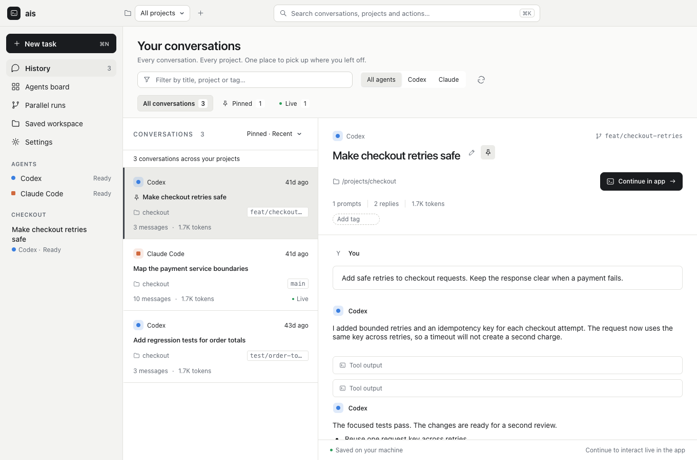

**Stop response** asks first, then terminates that response's local process group. Files already
changed remain changed; stopping is not an undo. Send a new message to continue
using the provider's saved session. Up to eight responses can run concurrently,
with up to 100 open conversations. Continuing an already-open native session selects the
existing conversation instead of creating another copy.

Unsent messages are saved on this Mac as you type, separately for each desktop
conversation. Closing a conversation or restarting the app keeps the draft. It is cleared
after a successful send or when you choose **Discard draft**; a failed send keeps
the text. Drafts use the app WebView's local storage, separate from provider
transcripts and `desktop-chats` records. Clearing the app's website data removes
them. If storage is unavailable or full, the composer tells you to keep a copy;
you can still write and send messages.

Open conversations and review metadata persist across restarts. Closing a
conversation hides it and retains its local record. Normal provider conversations can be reopened from
History; a review can also reopen its original conversation.

Choose **Saved workspace** in the sidebar to find desktop conversations and independent reviews, including closed ones and fresh
conversations that have not sent a message yet. Filter by project or type, or
search titles, project paths and agents. The list includes review completion,
finding/sent counts and file counts.

**Reopen** restores the same conversation and its saved state; **View** selects an
already open one. Neither starts an agent or consumes model usage. Reviews retain their
captured diff and findings, including sent markers, even if their project folder
has moved or is temporarily unavailable. Sending messages or requesting fixes
still requires an available project and the normal snapshot checks. Opening a
review's **Original conversation** link also saves that conversation's reopened state.
Use **Esc** or the close button to leave the library. Native provider sessions
remain available from History as before.

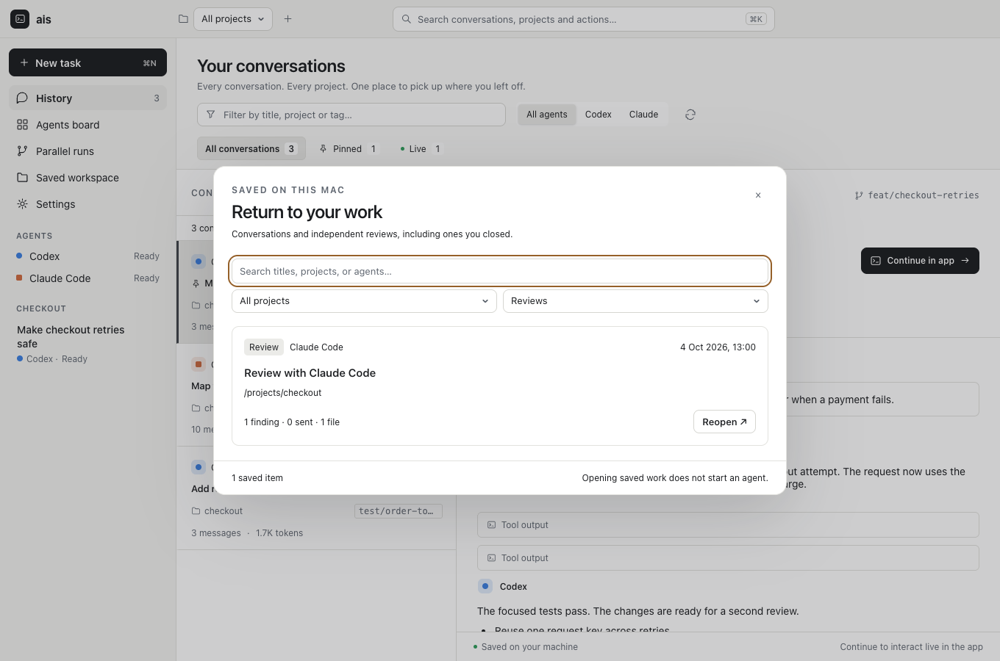

Quitting asks for confirmation if an agent is running. **Cancel** keeps the app
open; **Quit and stop agents** stops the local processes. Files the agents already
edited, conversations, drafts and review snapshots are kept. **Stop response** in
a conversation asks in the same way before ending a response. Running responses do
not survive an app restart. An interrupted conversation shows a stopped state, with no
stale approval buttons. Existing external terminal processes are not attached;
avoid simultaneously continuing the same native session in two applications.

## Choose a model and reasoning effort

The composer has **Model** and **Reasoning** selectors. Model names and supported
effort levels come from the installed agent; they are not a fixed list in ais.
Choose a model, then an effort level if that model supports it. Changing models
resets the effort override. **Agent default** leaves the choice to the provider's
settings; explicitly returning Codex to default resolves its configured model and
supported default effort, so a prior ais selection is not silently retained.

Choices are saved per conversation and applied to the next message, including
when continuing the same native session. Controls are disabled while a response
is running and while a setting is being saved. Existing conversations without
saved model preferences keep the provider's inherited behavior.

In the review preview, **Reviewer model** and **Reasoning** are separate choices.
They are remembered on the original conversation for future reviews. Sending
findings back uses the original conversation's coding model preferences.

A reply's model label comes from the agent's reported model, including reported
reroutes; it is not copied from the selection menu. Older imported messages or
provider events without model metadata may have no label. Completed reviews
show their reported model in the review banner.

**Refresh** reloads the catalog. Lists are otherwise cached for five minutes,
scoped by provider and project; reviewers use the same empty-directory scope as
review execution. Discovery initializes the CLI and requests metadata without
sending a prompt. Account restrictions still apply: a catalog entry is not proof
that a request will be authorized. Provider failures appear in the conversation.
An unavailable saved model stays visible until you select a replacement; ais does
not silently replace your saved choice.

If discovery fails, the picker shows the error and retains an **Agent default**
option. You can clear overrides or retry discovery after fixing the CLI. Models
with no advertised effort levels expose only the default effort. Cost estimates
and account usage displays are not part of these controls.

## Review with the other agent

The diff preview shows the selected file and added/removed line counts.
Use **↑/↓**, **Home**, and **End** in the file list to switch files, or click a
finding's file/line link to focus its location. **Wrap lines** makes long patches
easier to read. At larger window sizes, the **Files** slider adjusts the file
panel width. The code area is keyboard focusable for scrolling.

For example: implement with Codex, review with Claude Code, then return selected
findings to Codex for investigation and fixes. The reverse direction also works.

1. Finish or stop the original response, then click **Review with Claude Code**
   or **Review with Codex** in its header.
2. Inspect the file-by-file diff preview. The scope is **all current uncommitted
   changes relative to HEAD** in the Git working tree: staged, unstaged and eligible
   untracked files. This may include your own edits and changes from other tools.
   It is not limited to edits attributed to the selected conversation.
3. Click **Send snapshot**. This sends the displayed patch to the other provider
   using its installed account and can consume that provider's usage allowance.
   A separate review tab appears. The reviewer receives a fixed snapshot and is
   instructed to analyze it without editing or running commands. It runs from an
   empty temporary directory; Codex uses its read-only sandbox and Claude runs
   with tools, MCP servers and slash commands disabled.
4. Read the summary and findings. Click a file/line link to see its location in
   the captured diff. Findings are suggestions, not proof that an issue exists.
5. Select findings and click **Send findings**. The original conversation receives
   a request to verify them, fix valid issues and run relevant checks. Its normal
   approval flow remains active. This does not apply a patch automatically.

The app checks the snapshot again before starting the review and before sending
findings back. If the working tree changed, capture a fresh review. A preview is
single-use and expires after ten minutes. Already-sent findings cannot be sent
again through the same review.

Review requires a Git repository with an initial commit. Each snapshot is limited
to 100 changed files and 512 KiB of diff text. Binary contents and non-regular
untracked files are omitted with warnings; ignored files are excluded. Large
changes must be narrowed first. Findings must reference files and visible lines
in the snapshot, or use line zero for a file-level observation. Invalid reviewer
output is shown as an error and cannot be handed back as accepted findings.

## Parallel runs

Choose **Parallel runs** in the sidebar to monitor saved runs from the CLI or
desktop. Filter by project, select a run and task, then choose **All changes** or
a changed file. The dashboard shows the pane's process state, exit code, current
branch, worktree path, changed files and separate event/silence alerts. Missing
worktrees are reported per task; Git review remains available when tmux cannot
be inspected. Status refreshes every five seconds while the dashboard is open,
preserving task and file selection. **Refresh runs** also reloads saved manifests.

**Copy attach command** copies a tmux command for the selected task when its
pane is available. Paste it into a new terminal outside an existing tmux session
to answer questions or approvals in the agent's normal UI. The ais CLI is not
required. Copying does not execute the command or start another agent.

Use **New parallel run** to choose a project and agent and enter independent
task prompts. Each task gets a branch, worktree and tmux window at the same
committed HEAD. Uncommitted changes are not copied. The launch action starts
real local agents with their normal settings and approvals; it requires Git,
tmux and the chosen agent on PATH. There is no automatic commit or merge.
If setup fails partway through, saved manifests and work remain discoverable.

**Stop run…** opens a confirmation before terminating that run's tmux session.
Branches, worktrees and saved changes remain. A daemon-backed provider may
continue after its terminal exits; pane state and alerts do not prove it has
finished or is still waiting. Stop or pause agents before treating a diff as
final. A stopped run remains reviewable. Patch display is limited to 512 KiB;
select a file or use `ais run diff <id>` for the complete output.

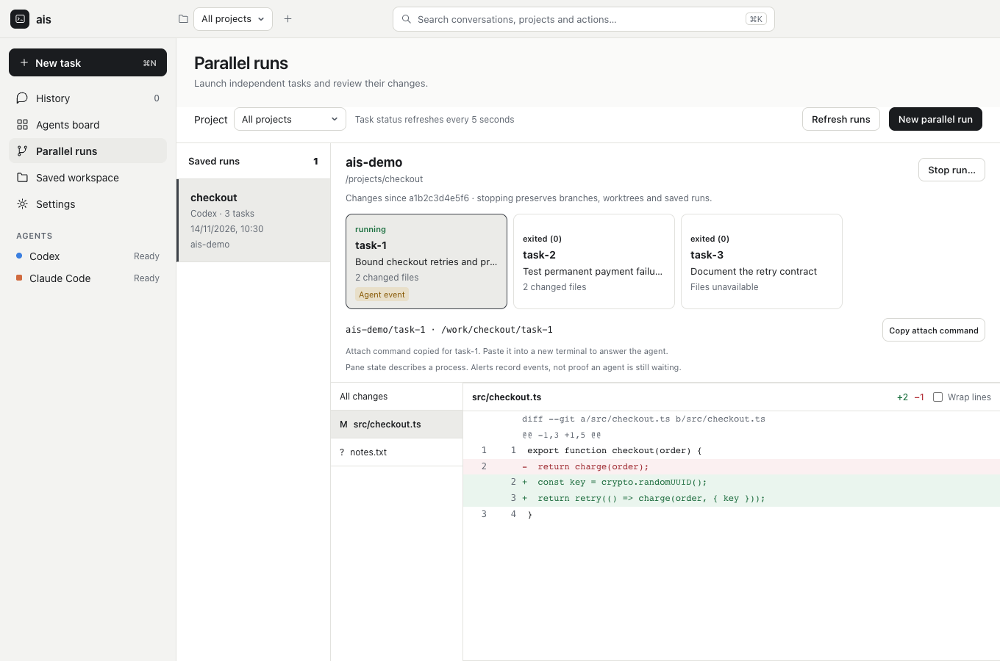

The fixture-only browser check is reproducible with:

```sh
AIS_PLAYWRIGHT_MODULE=/tmp/ais-ui-check/node_modules/playwright/index.mjs \
  node scripts/run-screenshots.mjs
```

It checks task/file selection, refresh, missing worktrees, explicit stop
confirmation, multiline task launch and the minimum window size, without
launching a provider or tmux. `AIS_SCREENSHOT_DIR` chooses an output directory.

## Agent discovery and local data

Finder does not load shell startup files. The app checks its inherited `PATH`
plus `~/.local/bin`, `/opt/homebrew/bin`, `/usr/local/bin` and standard system
locations. For custom installations, launch from a configured terminal:

```sh
./desktop/build/bin/ais-desktop.app/Contents/MacOS/ais-desktop
```

The app honors `CODEX_HOME`, `CODEX_SQLITE_HOME`, `CLAUDE_CONFIG_DIR`,
`AIS_CACHE_DIR` and `AIS_DATA_DIR`. Provider processes inherit your environment and
use their own sign-in. Recent projects live in `desktop-projects.json` under the
ais data directory. Desktop conversations and captured review patches are stored
in `desktop-chats/*.json` in that directory, using owner-only file permissions.
These records can contain source code, prompts and tool output. Provider-native
transcripts remain in the provider's own store.

The history preview contains up to 200 recent messages, each capped at 20,000 bytes.
Chat display retains up to 500 messages / 2 MiB of message text, with individual
messages capped at 100,000 bytes. A notice indicates shortened history. Embedded
HTML and remote images are not activated; links render as text. The provider's
native saved conversation is unaffected by display limits.

If startup fails, check installation and sign-in in the agent's CLI. `ais setup`
and `ais doctor` provide provider diagnostics. Restore moved or missing project
folders before continuing their sessions. **Reconnect** retries the desktop state
connection; it does not restart a failed model response. An initialization timeout
or unsupported protocol usually means the CLI needs attention or an update.

Git worktrees and nested repositories remain separate projects. Without Git,
projects match their exact directory. Archived native sessions are hidden. CLI
renames, pins and tags appear after refreshing.

## Development and validation

```sh
cd desktop/frontend
npm ci
npm run lint
npm run format:check
npm test
npm run build
cd ..
go vet ./...
go test -race ./...
wails dev
```

After a frontend build, `sh scripts/ui-check.sh` (from the repository root, with
Google Chrome installed) runs the fixture-based browser checks in light and dark:
text contrast, overflow and the 960×640 minimum window. CI runs the same script.
It installs a pinned Playwright into a temporary folder unless
`AIS_PLAYWRIGHT_MODULE` points at one, and writes captures to
`AIS_SCREENSHOT_DIR` if set.

Build the frontend before ordinary Go tests because the app embeds `frontend/dist`.
`wails dev` starts Go and Vite together; opening Vite alone does not provide the
native bridge. `frontend/src/api.ts` defines the typed `window.go.main.App` API.
Production builds skip unused generated bindings; Go and frontend API types must
be updated together.

Codex uses the [app-server protocol](https://learn.chatgpt.com/docs/app-server).
Claude Code uses its bidirectional stream-JSON CLI interface, including the
[streaming output](https://code.claude.com/docs/en/agent-sdk/streaming-output) and
[user-input control flow](https://code.claude.com/docs/en/agent-sdk/user-input).
The conversation view does not poll on a timer. `ReadChat` waits in the backend
until the conversation changes (up to 20 seconds), then returns only the messages
changed since the caller's version; the frontend merges them and re-renders only
those rows (`frontend/src/chatUpdates.ts`). If a partial update does not fit, the
frontend reads the whole conversation again.

At startup, and from **Settings › Agents › Check again**, the app asks each
installed agent for its version and whether it still accepts the options ais
starts it with (`claude … --version` with the conversation options, and
`codex app-server --help`). This contacts no model. Settings shows the version
and reports **Not compatible** with the tool's own error if an option is rejected,
naming a version known to work (`testedAgentVersions` in `desktop/chat_health.go`).
ais always runs the agent version installed on the Mac; it does not pin one. Claude Code's
`--permission-prompt-tool` option is not listed in its `--help`, and newer versions
list `manual` rather than `default` for `--permission-mode`; both were still
accepted by Claude Code 2.1.325 on 2026-11-14.

Each response starts a provider process, resumes its native conversation ID where
available, and reaps the process on completion or stop. CLI compatibility is
version-sensitive. On November 15, 2026, the authenticated checks passed with
Codex 0.167.1 and Claude Code 2.1.325: new/resumed conversations, explicit
model selection, saved settings and conversation recovery after restart,
stop/continue, command approval denial and acceptance, both directions of the
review-to-fix loop, Claude Code writing an "always allow" rule into a temporary
project's settings and then not asking again, and plan mode writing nothing with
either agent, and both agents naming the color of an attached image. Codex's
"always allow this command" was not exercised live, because
it would add a rule to the real Codex settings on the machine running the check. Each fix was checked independently in a temporary repository.
The checks also caught and fixed an early-stop bug: a new Claude conversation no
longer retains an unusable session ID when stopped before its first model activity.

Backend tests use real local fixture subprocesses for both providers to exercise
streaming, native resume IDs, approval decisions, duplicate requests, malformed
output, stopping, persistence and process cleanup. Temporary Git repositories
exercise diff capture, review validation, cross-provider handoff and stale-snapshot
rejection. Frontend tests cover chat, approvals, review previews, finding selection,
late responses and history workflows. Model-control tests cover catalog pagination,
unsupported choices, defaults, preference persistence, resumed sessions, provider
model reporting, save failures and separate reviewer preferences. The earlier PTY implementation and its tests
remain available internally; the main UI now uses structured chat.

### Live compatibility checks

Ordinary `go test` skips authenticated checks. To repeat them from `desktop/`,
install and sign in to both CLIs, ensure `node` and `git` are on your PATH, then run:

```sh
AIS_TEST_INSTALLED_MODELS=1 go test -run '^TestInstalledModelCatalogs$' -v -count=1
AIS_TEST_LIVE_AGENTS=1 go test -run '^TestLive' -v -count=1 -timeout=15m
```

The first command queries catalogs without model turns. The second consumes real
model usage and creates native provider sessions. It uses temporary projects and
temporary app state, stops long responses as soon as output begins, and approves
only a fixed `printf` command or narrowly scoped fixture edits/test commands.
Provider-native session history may remain after the temporary projects are removed.
Unexpected approval requests fail the check without being granted. Select one
check/provider with Go's subtest filter, for example
`-run '^TestLiveStopFirstTurn$/claude$'`.

These are backend integration checks, not native window automation. Before release,
also manually check folder selection, tab switching, resizing, quit confirmation,
and the rendered live chat, approval and review controls in the macOS app.

### Reproduce the screenshots

With Google Chrome installed, start `npm run dev -- --port 5183` in
`desktop/frontend`. In another terminal, install Playwright into a temporary
folder and run the fixture-based visual check from the repository root:

```sh
npm install --prefix /tmp/ais-ui-check --no-audit --no-fund playwright@1.58.2
AIS_PLAYWRIGHT_MODULE=/tmp/ais-ui-check/node_modules/playwright/index.mjs \
  node scripts/desktop-screenshots.mjs
```

This replaces the desktop screenshots with fresh renders, checks a
960×640 viewport, and writes a small-window capture into the system temporary
directory. It injects fictional provider responses into a fresh browser context;
it does not read real conversations or contact an AI provider.

Repeat with `AIS_APPEARANCE=dark` to capture the dark screenshots and run the same
checks in that appearance. The script checks real rendered text contrast,
appearance persistence across reload, system appearance changes, approval/error
states, and the minimum window size. `AIS_SCREENSHOT_DIR` selects a different
output folder for validation without replacing documentation images.

## Current scope

The desktop app provides history browsing, graphical conversations and a
cross-provider review/fix workflow and parallel-run dashboard on macOS. Titles,
pins and tags can be edited from the History preview; they are ais annotations
shared with the CLI, and the agent's own transcript is not changed. The paperclip
in the composer adds the paths of chosen files to your message; the agent opens
them itself and nothing is uploaded. Image and binary attachments, full provider
slash-command
parity, Windows/Linux support, and signed releases remain
future work. The CLI retains its session-management and parallel-task workflows.
