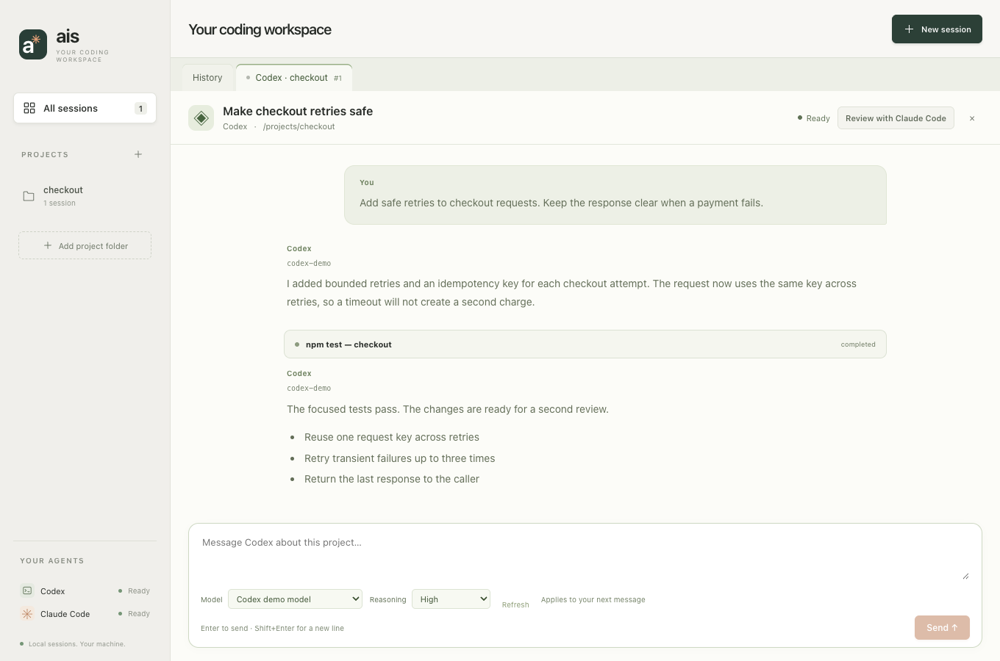
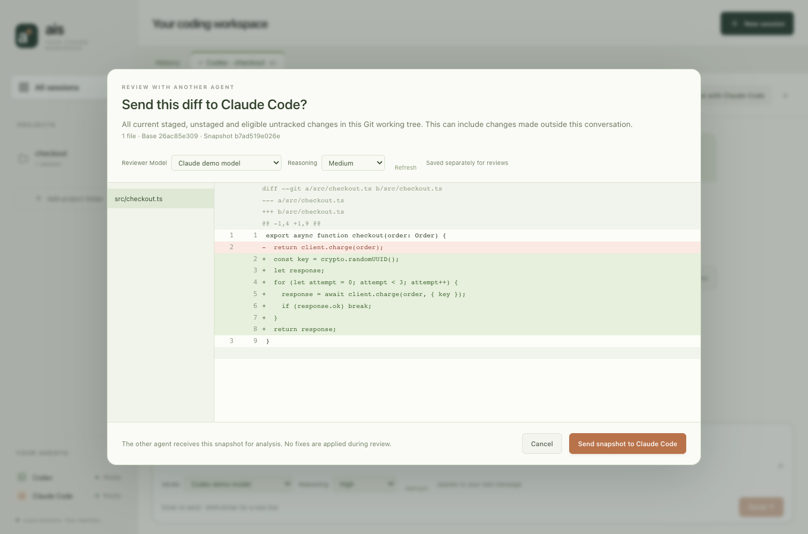
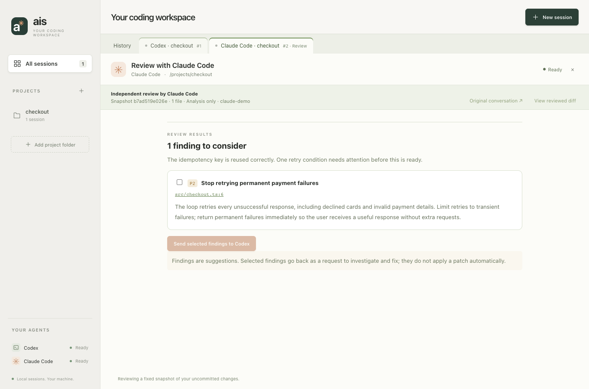

# ais desktop

A shared graphical workspace for Claude Code and Codex. Browse existing sessions,
continue them with streaming chat, and ask the other agent to review a captured
Git diff. Replies, tool activity, questions and approvals appear directly in the
app. The desktop app shares session readers, project rules, search and annotations
with the `ais` CLI.

## Build and open

This version targets macOS 13 or newer. Building requires Go 1.25+, Node.js 22.12+
with npm, and Xcode Command Line Tools. Go 1.24.7 remains sufficient for the CLI.
Desktop dependencies live in the separate `desktop/go.mod` module.

Install the pinned Wails tool:

```sh
go install github.com/wailsapp/wails/v2/cmd/wails@v2.15.0
export PATH="$(go env GOPATH)/bin:$PATH"
```

From the repository root:

```sh
sh scripts/build-desktop.sh
open desktop/build/bin/ais-desktop.app
```

The script installs locked frontend dependencies and packages a native app for
your Mac's architecture. The resulting app needs neither Go nor Node to run;
you can move it to Applications. Install and sign in to Codex or Claude Code
separately. Only the provider you use is needed for chat; cross-provider review
requires both. Saved-history browsing works without either executable installed.

This is a local development build with ad-hoc signing. A Developer ID signed,
notarized download is not yet published. The Homebrew CLI package does not install
the desktop app.

## Screenshots

These show the real React interface with fictional conversations and review data.
They demonstrate the layout, not output from a live model run.







## Start or continue a conversation

1. Select a project or **All sessions**. Search titles, project paths, branches,
   tags and conversation contents; use the provider filters to narrow results.
2. Select a saved conversation to preview it. **Continue in app** opens that
   provider's saved session in its recorded directory.
3. For a fresh conversation, choose **New session**, select a project and provider,
   then **Start in app**. Use **Browse** to choose another folder. The app remembers
   the twelve most recently added project folders.
4. Type in the message box. **Enter** sends; **Shift+Enter** inserts a new line.
   A new provider process starts when you send the first message. Responses stream
   into message bubbles, and expandable tool cards show commands and their output.
5. Answer questions or choose **Allow once** / **Decline** on approval cards.
   Approvals retain the installed agent's normal permission behavior; ais does
   not bypass permissions. Unsupported requests fail closed and may require the CLI.

Switch tabs or return to **History** while an agent works. **⌘K** opens history
search, **⌘N** opens New session, and **Esc** closes the new-session dialog.
History refreshes when a response finishes; the refresh button rescans manually.

**Stop response** terminates that response's local process group. Files already
changed remain changed; stopping is not an undo. Send a new message to continue
using the provider's saved session. Up to eight responses can run concurrently,
with up to 100 open tabs. Continuing an already-open native session selects the
existing conversation instead of creating another copy.

Open tabs and review metadata persist across restarts. Closing a tab hides it
and retains its local record. Normal provider conversations can be reopened from
History; a review can also reopen its original conversation. A dedicated browser
for closed review records is not implemented yet. Keep review tabs open when you
want easy access to their findings.

Quitting asks for confirmation if an agent is running. **Keep working** cancels
the quit; **Stop and quit** stops the local processes. Running responses do not
survive an app restart. An interrupted saved tab shows a stopped state, with no
stale approval buttons. Existing external terminal processes are not attached;
avoid simultaneously continuing the same native session in two applications.

## Choose a model and reasoning effort

The composer has **Model** and **Reasoning** selectors. Model names and supported
effort levels come from the installed agent; they are not a fixed list in ais.
Choose a model, then an effort level if that model supports it. Changing models
resets the effort override. **Agent default** leaves the choice to the provider's
settings; explicitly returning Codex to default resolves its configured model and
supported default effort, so a prior ais selection is not silently retained.

Choices are saved per conversation and applied to the next message, including
when continuing the same native session. Controls are disabled while a response
is running and while a setting is being saved. Existing conversations without
saved model preferences keep the provider's inherited behavior.

In the review preview, **Reviewer model** and **Reasoning** are separate choices.
They are remembered on the original conversation for future reviews. Sending
findings back uses the original conversation's coding model preferences.

A reply's model label comes from the agent's reported model, including reported
reroutes; it is not copied from the selection menu. Older imported messages or
provider events without model metadata may have no label. Completed reviews
show their reported model in the review banner.

**Refresh** reloads the catalog. Lists are otherwise cached for five minutes,
scoped by provider and project; reviewers use the same empty-directory scope as
review execution. Discovery initializes the CLI and requests metadata without
sending a prompt. Account restrictions still apply: a catalog entry is not proof
that a request will be authorized. Provider failures appear in the conversation.
An unavailable saved model stays visible until you select a replacement; ais does
not silently replace your saved choice.

If discovery fails, the picker shows the error and retains an **Agent default**
option. You can clear overrides or retry discovery after fixing the CLI. Models
with no advertised effort levels expose only the default effort. Cost estimates
and account usage displays are not part of these controls.

## Review with the other agent

For example: implement with Codex, review with Claude Code, then return selected
findings to Codex for investigation and fixes. The reverse direction also works.

1. Finish or stop the original response, then click **Review with Claude Code**
   or **Review with Codex** in its header.
2. Inspect the file-by-file diff preview. The scope is **all current uncommitted
   changes relative to HEAD** in the Git working tree: staged, unstaged and eligible
   untracked files. This may include your own edits and changes from other tools.
   It is not limited to edits attributed to the selected conversation.
3. Click **Send snapshot**. This sends the displayed patch to the other provider
   using its installed account and can consume that provider's usage allowance.
   A separate review tab appears. The reviewer receives a fixed snapshot and is
   instructed to analyze it without editing or running commands. It runs from an
   empty temporary directory; Codex uses its read-only sandbox and Claude runs
   with tools, MCP servers and slash commands disabled.
4. Read the summary and findings. Click a file/line link to see its location in
   the captured diff. Findings are suggestions, not proof that an issue exists.
5. Select findings and click **Send findings**. The original conversation receives
   a request to verify them, fix valid issues and run relevant checks. Its normal
   approval flow remains active. This does not apply a patch automatically.

The app checks the snapshot again before starting the review and before sending
findings back. If the working tree changed, capture a fresh review. A preview is
single-use and expires after ten minutes. Already-sent findings cannot be sent
again through the same review.

Review requires a Git repository with an initial commit. Each snapshot is limited
to 100 changed files and 512 KiB of diff text. Binary contents and non-regular
untracked files are omitted with warnings; ignored files are excluded. Large
changes must be narrowed first. Findings must reference files and visible lines
in the snapshot, or use line zero for a file-level observation. Invalid reviewer
output is shown as an error and cannot be handed back as accepted findings.

## Agent discovery and local data

Finder does not load shell startup files. The app checks its inherited `PATH`
plus `~/.local/bin`, `/opt/homebrew/bin`, `/usr/local/bin` and standard system
locations. For custom installations, launch from a configured terminal:

```sh
./desktop/build/bin/ais-desktop.app/Contents/MacOS/ais-desktop
```

The app honors `CODEX_HOME`, `CODEX_SQLITE_HOME`, `CLAUDE_CONFIG_DIR`,
`AIS_CACHE_DIR` and `AIS_DATA_DIR`. Provider processes inherit your environment and
use their own sign-in. Recent projects live in `desktop-projects.json` under the
ais data directory. Desktop conversations and captured review patches are stored
in `desktop-chats/*.json` in that directory, using owner-only file permissions.
These records can contain source code, prompts and tool output. Provider-native
transcripts remain in the provider's own store.

The history preview contains up to 200 recent messages, each capped at 20,000 bytes.
Chat display retains up to 500 messages / 2 MiB of message text, with individual
messages capped at 100,000 bytes. A notice indicates shortened history. Embedded
HTML and remote images are not activated; links render as text. The provider's
native saved conversation is unaffected by display limits.

If startup fails, check installation and sign-in in the agent's CLI. `ais setup`
and `ais doctor` provide provider diagnostics. Restore moved or missing project
folders before continuing their sessions. **Reconnect** retries the desktop state
connection; it does not restart a failed model response. An initialization timeout
or unsupported protocol usually means the CLI needs attention or an update.

Git worktrees and nested repositories remain separate projects. Without Git,
projects match their exact directory. Archived native sessions are hidden. CLI
renames, pins and tags appear after refreshing.

## Development and validation

```sh
cd desktop/frontend
npm ci
npm test
npm run build
cd ..
go vet ./...
go test -race ./...
wails dev
```

Build the frontend before ordinary Go tests because the app embeds `frontend/dist`.
`wails dev` starts Go and Vite together; opening Vite alone does not provide the
native bridge. `frontend/src/api.ts` defines the typed `window.go.main.App` API.
Production builds skip unused generated bindings; Go and frontend API types must
be updated together.

Codex uses the [app-server protocol](https://learn.chatgpt.com/docs/app-server).
Claude Code uses its bidirectional stream-JSON CLI interface, including the
[streaming output](https://code.claude.com/docs/en/agent-sdk/streaming-output) and
[user-input control flow](https://code.claude.com/docs/en/agent-sdk/user-input).
Each response starts a provider process, resumes its native conversation ID where
available, and reaps the process on completion or stop. CLI compatibility is
version-sensitive; initialization was checked with Codex 0.160.0 and Claude Code
2.1.283. Model catalog discovery was also checked against both installed CLIs without
starting model turns. These checks do not prove all authenticated model and tool
flows work.

Backend tests use real local fixture subprocesses for both providers to exercise
streaming, native resume IDs, approval decisions, duplicate requests, malformed
output, stopping, persistence and process cleanup. Temporary Git repositories
exercise diff capture, review validation, cross-provider handoff and stale-snapshot
rejection. Frontend tests cover chat, approvals, review previews, finding selection,
late responses and history workflows. Model-control tests cover catalog pagination,
unsupported choices, defaults, preference persistence, resumed sessions, provider
model reporting, save failures and separate reviewer preferences. The earlier PTY implementation and its tests
remain available internally; the main UI now uses structured chat.

Before release, manually exercise both signed-in agents: new and resumed chats,
real tool approvals, stop/resume, folder selection, tab switching, resizing, quit
confirmation, and both review directions. Automated fixtures and initialization
handshakes do not replace an authenticated end-to-end release smoke test.

### Reproduce the screenshots

With Google Chrome installed, start `npm run dev -- --port 5183` in
`desktop/frontend`. In another terminal, install Playwright into a temporary
folder and run the fixture-based visual check from the repository root:

```sh
npm install --prefix /tmp/ais-ui-check --no-audit --no-fund playwright@1.58.2
AIS_PLAYWRIGHT_MODULE=/tmp/ais-ui-check/node_modules/playwright/index.mjs \
  node scripts/desktop-screenshots.mjs
```

This replaces the three desktop screenshots with fresh renders, checks a
960×640 viewport, and writes a small-window capture into the system temporary
directory. It injects fictional provider responses into a fresh browser context;
it does not read real conversations or contact an AI provider.

## Current scope

The desktop app provides history browsing, graphical conversations and a
cross-provider review/fix workflow on macOS. Parallel-run dashboards, GUI editing
of tags and titles, attachment support, full provider slash-command
parity, closed-review browsing, Windows/Linux support, and signed releases remain
future work. The CLI retains its session-management and parallel-task workflows.
